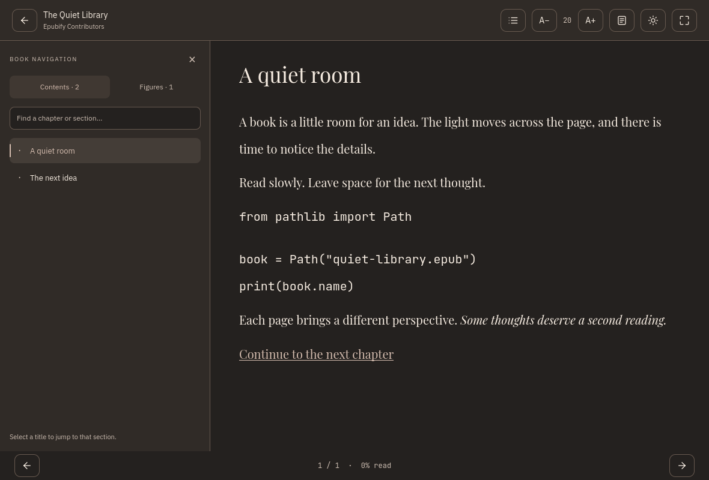

# Epubify

A local-first desktop EPUB reader built with Python 3.13 and Qt 6.12.
Its own native reading library uses QTextDocument for rich text/CSS layout,
QPainter for page rendering, and Qt Quick for the interface and transitions.



This is a capture of the actual reader with an original generated test EPUB.
[Reading surfaces](docs/design/reading-surfaces-running.png) ·
[Figure navigation](docs/design/figures-running.png) ·
[Compact in-book contents](docs/design/contents-compact-running.png) ·
[Library capture](docs/design/library-footer-running.png) · [SVG concept](docs/design/library-preview.svg)

## Run

Install [uv](https://docs.astral.sh/uv/getting-started/installation/), then:

```sh
uv sync --locked
uv run epub-reader
```

For the existing development environment, `.venv/bin/epub-reader` also works.
Use **Import EPUBs** or **Ctrl+O** to select one or several books (Ctrl/Shift in
the file picker), then open a book card. Batch import reports progress and offers
**Import details** for added books, duplicates and failures. Books and preferences stay
in platform application data storage. The original EPUB can be removed after import.

```sh
uv run pytest
uv run ruff check .
uv run ruff format --check .
uv run mypy
uv run python scripts/make_demo.py demo.epub
```

The runtime uses the official **PySide6 6.12.0** distribution. Qt's current
metapackage also installs extra components, including WebEngine wheels; those
components are outside this application's native reading pipeline. Rendering uses
QTextDocument, QPainter and Qt Quick, with no browser process, CDN or web server.

## Features

- Persisted library with background import, safe extraction, deduplication, covers,
  title/author filtering, favorites, automatic local metadata-based categories,
  and reading-progress indicators.
- Native EPUB 2/3 spine and contents navigation, next/previous pages, internal links,
  images, and the HTML/CSS features supported by Qt rich text.
- Hierarchical contents with indentation, collapsible groups, filtering and the current
  section highlighted. Clickable figure lists use the EPUB index or a background
  scan of captions/alternative text when no index is provided. Semantically marked
  in-book contents pages also receive compact spacing and indentation from the index.
- JSON color schemes shared by the interface/reader, with a persistent scheme
  selector, warm Parchment, Stormcloud, Windows and macOS schemes. [Adding palettes](docs/themes.md).
- Settings with live, persistent English, Simplified Chinese, Spanish, French,
  German, Japanese, Portuguese and Italian UI translations.
- Page notes with editing, deletion and navigation to the saved location.
- Opt-in local P2P sync: mDNS, pinned TLS 1.3 WebSockets, single-use device
  invitations, book/progress/note/favorite/preference replication, reconnection,
  retained offline conflicts and manual resolution. [Sync and trust model](docs/synchronization.md).
- Bundled IBM Plex Sans for the UI, Playfair Display for reading, JetBrains Mono
  for code, and the supplied application icon. Fonts work offline.
- Font sizing, light/dark themes, six persisted page surfaces (classic, paper, sepia,
  slate, grid and dots), focus mode, keyboard controls, reduced motion and native
  fade/slide page transitions.
- Resume positions stored as versioned chapter paths and Qt text offsets, retained
  through font/viewport changes. Existing libraries migrate without deleting books.

| Action | Shortcut |
| --- | --- |
| Import / search library | Ctrl+O / Ctrl+L |
| Next / previous page | Right / Left, PgDown / PgUp |
| Contents / focus mode | Ctrl+T / F11 |
| Return to library | Escape |

Use the paper icon in the reader toolbar to choose a page surface. Paper, sepia
and slate keep their own palette; classic, grid and dots follow the interface
light/dark setting. Surface changes retain the reading position. The contents
button opens the sidebar; its tabs switch between chapters and figures. Chevron
buttons expand/collapse groups, while titles jump to their linked positions.

## Compatibility and limits

QTextDocument implements a subset of HTML 4 and CSS, not the complete EPUB web
platform. Reader typography/colors take precedence; structural styles such as
alignment, emphasis, headings, margins, tables and lists are retained where Qt
supports them. Complex CSS layouts, embedded EPUB fonts, scripts, DRM, fixed-layout
books, audio/video, text highlights, full text search, selection handles and
page-curl shaders are not implemented. See [native engine design](docs/architecture.md).

Text layout and rasterization run on the CPU; Qt Quick composes cached page
textures. High-DPI behavior is tested. No startup or frame-rate guarantee is claimed.
A physical Windows/macOS desktop and standalone installers still need validation.
P2P protocol and TLS tests pass in memory; real network/mDNS acceptance remains
pending where the runner blocks sockets. Android debug APKs have been generated
and the emulator launch confirmed; complete mobile acceptance and iOS builds remain pending.
See [mobile requirements and limits](docs/mobile.md).

On Android, Epubify imports books from the system file picker, appears in the
"Open with" chooser for EPUB files and paints the status/navigation bars with the
active palette ([Android integration](docs/mobile.md#android-system-integration)).

To attempt the experimental Android ARM64 debug build on a prepared host, run
`uv run python scripts/android.py apk --arch aarch64 --accept-licenses`.
It installs the isolated toolchain and writes a verified build to `dist/android/`
only if compilation and APK checks succeed.

Use `uv run epub-reader --mobile-preview` to iterate on the responsive Qt/QML layout
at 411×914 logical pixels without rebuilding Android. Add `--data-dir build/mobile-preview/data`
for a separate library. The latest mobile layout and page-stack animation are
validated in desktop previews; rebuild the APK when ready for Android-specific checks.

## Project map

- `domain/`, `services/`: plain models, repository contracts and application use cases.
- `infrastructure/`: SQLAlchemy persistence, bounded EPUB parsing/extraction and thumbnails.
- `rendering/`: reusable native publication, confined document, layout and pagination library.
- `presentation/`: Qt models/controllers and the native QML `BookPage` type.
- `infrastructure/sync/`, `platforms/`: signed replication and small OS adapters.
- `resources/`: QML screens, themes, SVG icons and future shader assets.
- `tests/`, `scripts/`, `.github/workflows/`: fixtures, checks and native build preparation.

Paths above are beneath `src/epub_reader/` where applicable. Read
[development](docs/development.md), [validation](docs/validation.md), and
[packaging](docs/packaging.md). Contributions are welcome: see [CONTRIBUTING.md](CONTRIBUTING.md). Application code is MIT; Qt and the bundled
OFL fonts retain their own licenses.
