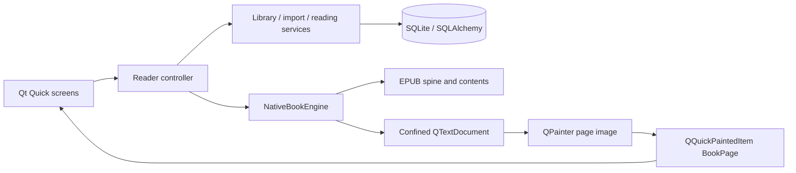

# Native reading architecture

Epubify uses an application-owned Python/Qt rendering library. `rendering/` has no
QML screen dependencies, JavaScript bridge, or browser process.

## Rendering library

`publication.py` parses EPUB 2 NCX and EPUB 3 navigation documents into chapters
and hierarchical navigation entries (label, target, depth and parent index).
EPUB 3 illustration navigation is retained when present. Otherwise a Qt worker
scans captions, alternative text and titles to build a bounded image index;
explicitly decorative images are excluded. Session tokens discard stale results
when switching books. The controller caches generated indexes for the session.
`document.py` prepares XHTML and linked CSS for QTextDocument and
provides a resource loader confined to the active book. `engine.py` sets the page
size, lays out a chapter, renders pages and navigates text offsets and anchors.

QTextDocument supports [a subset of HTML/CSS](https://doc.qt.io/qt-6/richtext-html-subset.html).
The engine keeps supported structural styles while overriding foreground,
background, base typography and line spacing for the reader's chosen theme.
Named EPUB ids become native text anchors. Raster/SVG images are bounded to the
page; image-only blocks use ordinary line height to avoid empty cover pages.
Image targets are matched to actual native image fragments, including repeated
sources. This avoids Qt moving an empty named anchor onto the following paragraph.
Internal text links receive underlines and the selected surface accent color.
Embedded font faces and complete browser CSS fidelity are outside this version.

QTextDocument layout and image decoding occur on the GUI thread. The paint callback
reads only the cached QImage; it does not manipulate QObjects or load resources
from the render thread. QQuickPaintedItem uploads that image to the scene graph.
The engine renders at the window's device-pixel ratio. Resizing is debounced;
large chapter layout can still pause the UI and requires future measurement/work.

## Positions and persistence

Positions are versioned JSON containing the spine chapter path and Qt text cursor
offset. Font/viewport changes locate the same offset in the new layout. Page
numbers change when layout changes. Progress is an approximate chapter/page fraction.

Schema version 2 adds `location`; old books/preferences and the legacy `cfi` column
are preserved. Old CFI values are not interpreted by the native engine. New
positions are debounced for 500 ms and flushed when switching books or exiting.
Services own use cases, repositories own short SQLAlchemy sessions, and Qt models
publish row updates without reloading the whole library. The QML engine owns its
context objects. Preferences retain the platform style-hints wrapper and child.

## Resource isolation

Import snapshots/hash the same source bytes and validates ZIP paths, links,
Windows device names, collisions, encryption, entry count, sizes and compression
ratios before extraction. XML entities/external entities are forbidden. Active HTML
is removed. The native document overrides resource loading: only resources resolving
beneath its book root can load. Remote/file origins are denied. Images are decoded
from memory with size limits; external SVG references are removed. No generic
filesystem access is exposed to QML or a publication.

## Navigation and page surfaces

`presentation/models/navigation.py` builds the visible outline, retaining matching
ancestors during filtering and tracking the active section and its parent trail.
QML provides separate contents/figure tabs, indentation, disclosure controls and
keyboard-focusable links. Navigating keeps the sidebar open.

`rendering/navigation_layout.py` also formats the visible contents/illustration
pages inside a publication, identified by EPUB navigation semantics or document
roles. Flat publisher headings receive the canonical index depth, matched by
link target or chapter/label when publishers use different anchor aliases.
Structural list/heading depth is the fallback. Native blocks use smaller margins,
regular child text and explicit indentation instead of full-size chapter headings.
Qt relative heading sizes and CSS pixel sizes are cleared on navigation fragments
and paragraph separators; original links, text and cursor offsets are preserved.
Ordinary chapter typography is unaffected by this navigation-specific policy.

`rendering/surfaces.py` owns six native page materials and their contrasting text
and link colors. Paper grain is deterministic and cached; grids/dots are painted
procedurally at logical coordinates. No texture downloads are needed. The QML `SurfacePreview` uses the same painter as the native reader.
SQLite stores the chosen surface independently of the interface theme; reflow
retains the native text offset. Reading surfaces require no schema migration.

## Scheme and font resources

`core/design.py` validates `resources/themes/*.json`, resolves named colors and
provides shared light/dark roles, cover colors and reading surfaces. Preferences
publish the active scheme to QML and native rendering together, persist selection,
and relayout at the current text offset. QML previews receive the same scheme ID.
See [theme editing](themes.md) for the schema and adding a palette without changing
screen code.

`core/typography.py` registers bundled regular/italic IBM Plex Sans, Playfair
Display and JetBrains Mono once per Qt application. Native fragments keep their
text/links/emphasis while receiving the configured serif or monospace family.
Semantic code tags enforce the monospace family even on nested styled spans.
Font binaries, original OFL licenses and pinned source hashes ship as package data.

## Batch import

A single QRunnable processes the selected local files sequentially, emitting
per-file progress/results to the GUI thread. Failure of one book leaves remaining
requests running; stable hashes recognize duplicates. Only successful books are
upserted into the library model. The UI offers an import report and aggregate
counts. Shutdown finishes the current file and stops pending queue entries before
disposing the database. An empty or concurrent submission leaves the active batch
unchanged.

## Effects and accessibility

Page images participate in ordinary Qt Quick composition. Native fade/slide
transitions honor reduced motion; future page curls can work from previous/next
page textures. A curl mesh, selection-aware interaction and shader implementation
remain future work. CPU rasterization and texture uploads have costs; benchmark
before adding full-screen blur or elaborate geometry.

Keyboard controls remain native. The current page's plain text is exposed as an
accessible description. Screen-reader testing, text selection handles and a richer
semantic accessibility tree are still required.

## Organization, localization and replication

SQLite schema 5 retains earlier books and adds categories, favorites, page notes
and signed sync state. Local classification uses bounded metadata rules; the
QAbstractListModel updates changed rows. QTranslator catalogs support eight UI
languages without changing EPUB content.

`infrastructure/sync` owns discovery, P-256 identities, pinned TLS WebSockets,
version vectors, concurrent branches and verified archive exchange.
`SyncController` owns an asyncio QThread and emits queued refreshes after commits.
QML presents pairing/conflict choices. `platforms/network.py` isolates Android's
foreground multicast lease. See [synchronization](synchronization.md) and
[mobile deployment gates](mobile.md).
